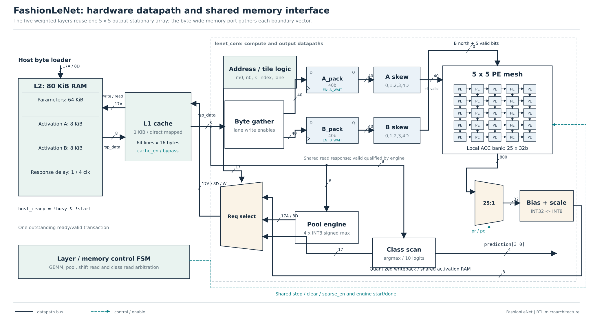
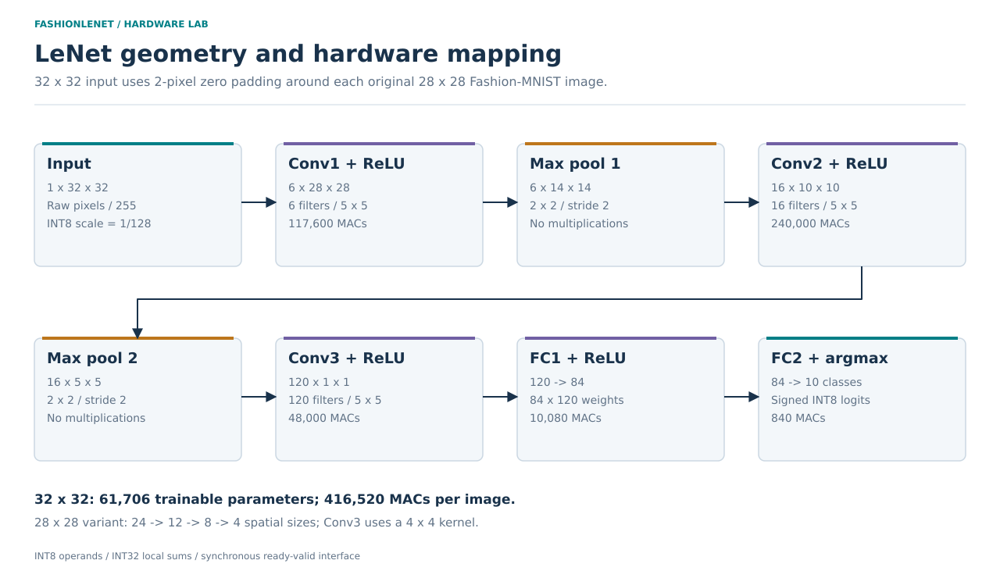
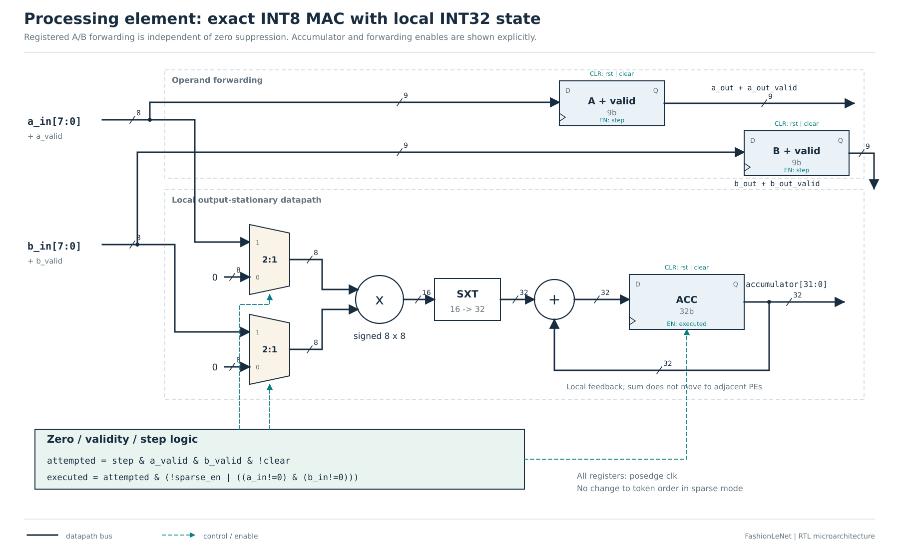
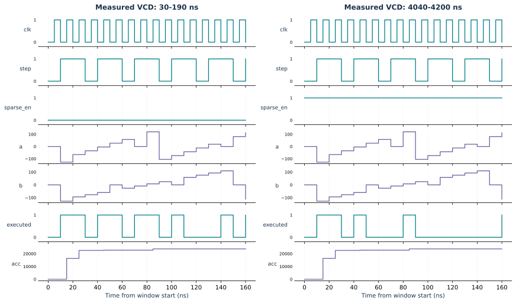

# FashionLeNet

**Fashion-MNIST LeNet-5: training, pruning, INT8 quantization, and a complete output-stationary SystemVerilog accelerator.**

Prepared for the supplied HWACC project brief. Maintainer: [Matin Firoozbakht](https://github.com/matinfirooz).



This repository connects a trained model to host-loadable hardware memory images,
a NumPy integer oracle, all five weighted RTL layers, pooling and a final predicted
class. It includes actual training, full-dataset software evaluation, pruning
experiments, real-operand RTL regressions, module testbenches, waveform traces,
editable architecture drawings and FPGA analysis scripts.

**Validation status:** Python tests, Icarus RTL simulations and generic Yosys
structural checks were run. Vivado implementation, FPGA primitive utilization,
achieved clock, power and on-board execution are pending; those fields are null.

## Contents

- [Measured results](#measured-results)
- [Installation](#installation)
- [Quick start](#quick-start)
- [Complete software experiment](#complete-software-experiment)
- [Hardware and memory](#hardware-and-memory)
- [RTL verification](#rtl-verification)
- [Timing model and CPU baseline](#timing-model-and-cpu-baseline)
- [FPGA synthesis and power](#fpga-synthesis-and-power)
- [Files and documentation](#files-and-documentation)
- [Reproducibility and submission](#reproducibility-and-submission)

## Measured results

Both models were trained and evaluated with the official Fashion-MNIST data.
The fit/validation split is 55,000/5,000 images; the test set has 10,000 images.

| Input geometry | FP32 test accuracy | Integer INT8 test accuracy | Dense MACs/image |
|---|---:|---:|---:|
| Native 28x28, software study | 88.84% | 88.79% | 281,640 |
| Zero-padded 32x32, hardware baseline | 89.30% | 89.03% | 416,520 |

The prescribed pruning sweep covers **25%, 50%, 70%, 90%, 95%, 97% and 99%** for
both global unstructured pruning and actual structural channel/neuron removal.
Each model is also calibrated and evaluated after INT8 PTQ. High pruning can
collapse accuracy; the full results are retained rather than only favorable rows.

| Native 28-input model | INT8 accuracy | INT8 dense parameter payload |
|---|---:|---:|
| Baseline | 88.79% | 45,139 bytes |
| 50% unstructured + 3 recovery epochs | 88.85% | 45,139 bytes |
| 50% structured + 3 recovery epochs | 85.50% | 11,792 bytes |

Unstructured zeroing leaves dense storage unchanged. The structured model removes
widths from `[6,16,120,84]` to `[3,8,60,42]`; dependent tensor dimensions shrink.
INT8 payload counts one byte per weight, four per bias and five layer shifts.
It is different from NPZ/ZIP file size and the padded 80 KiB memory image.

Actual RTL results for **32-input test image #0**, using a 5x5 array:

| Memory / mode | RTL clocks | Executed / candidate MACs |
|---|---:|---:|
| Single level, one-clock backing, dense | 1,520,524 | 416,520 / 416,520 |
| Four-clock L2, L1 disabled, zero gating | 2,366,413 | 241,553 / 416,520 |
| Four-clock L2 + 1 KiB L1, dense | 2,249,791 | 416,520 / 416,520 |
| Four-clock L2 + 1 KiB L1, zero gating | 2,249,791 | 241,553 / 416,520 |

Caching saves 4.93% of clocks against the **same four-clock L2**. Zero gating
suppresses 42.01% of MACs on this image and keeps the same schedule. MAC savings
are not measured power savings. This byte-serial implementation is a transparent
educational accelerator, not a claim of CPU speedup: even at a conditional
100 MHz, its cached inference would take 22.49791 ms. The measured local FP32 CPU
median is about 0.193 ms. The clock target has not been physically achieved.

Every full 32-input regression compares **6,518 INT32 results** before scaling,
**8,094 INT8 intermediate outputs**, ten logits, MAC counters and the class. The
integer accuracy above is a full-dataset reference measurement; stored RTL logs
cover selected complete images and configurations.


Detailed tables and limitations: [docs/RESULTS.md](docs/RESULTS.md).

## Installation

Python 3.10 or newer is required; the release was tested with Python 3.12.
Core inference/demo dependencies are NumPy and Matplotlib. PyTorch is optional
for training/pruning/checkpoints. Torchvision is not needed.

### Ubuntu / WSL / Linux

```bash
cd FashionLeNet
python3 -m venv .venv
source .venv/bin/activate
python -m pip install --upgrade pip
python -m pip install -e ".[train]"
sudo apt-get update
sudo apt-get install -y iverilog yosys
```

For a CPU-only PyTorch wheel, install it from the official index before the
editable package:

```bash
python -m pip install torch --index-url https://download.pytorch.org/whl/cpu
python -m pip install -e .
```

### Windows PowerShell

Run from the extracted directory containing `pyproject.toml`. These commands use
the actual environment interpreter, so PowerShell activation policy is irrelevant:

```powershell
cd C:\Users\surface\Downloads\FashionLeNet
py -3 -m venv .venv
.\.venv\Scripts\python.exe -m pip install --upgrade pip
.\.venv\Scripts\python.exe -m pip install -e ".[train]"
.\.venv\Scripts\python.exe scripts\run_project.py --profile offline --software-only
```

Use WSL for the Linux RTL commands, or install native Icarus with `iverilog` and
`vvp` on PATH. Vivado can be run from its configured Windows/Linux shell.
Do not use `.\FashionLeNet\.venv\...` after already entering the project folder.

## Quick start

### Offline arithmetic and hardware demo

No dataset, PyTorch checkpoint or network connection is required:

```bash
python scripts/run_project.py --profile offline
```

This creates a deterministic **untrained** integer model/input, runs software
tests, all module benches and a full synthetic RTL inference. It never reports
synthetic outputs as classification accuracy. Missing RTL tools cause an error.
To explicitly run only the software portion:

```bash
python scripts/run_project.py --profile offline --software-only
```

### Verify the included trained model

```bash
python scripts/run_rtl.py
python scripts/run_rtl.py --full --bundle examples/trained32
python scripts/run_project.py --profile verify
```

The first command runs the eleven module benches. The second checks one complete
trained image. `verify` runs the main memory/sparsity configurations, both input
geometries, the structurally narrowed and unstructured-pruned models, and checks
the independent timing model against each RTL report. No training/data download
is required for these exported fixtures.

### Reproduce the complete project

```bash
python -m pip install -r requirements-figures.txt
python scripts/run_project.py --profile full --data data
```

This downloads/verifies data, trains both geometries, performs calibration and
test evaluation, runs all fourteen pruning settings plus baselines, performs
the three-epoch recovery study, exports models, times the CPU, verifies RTL,
checks the clock model, and regenerates figures/report tables. Runtime depends
on your CPU. The raw dataset and compiled simulator programs are not in the ZIP.

## Complete software experiment

### 1. Download and verify Fashion-MNIST

```bash
fashionlenet download --data data
```

The four gzip IDX files are downloaded from the official repository and verified
against its MD5 checksums before parsing. Input images are grayscale uint8. The
32-input path divides by 255 and pads two zero pixels per side; the 28-input
path uses the native shape. All training runs use seed 42, Adam, batch size 128,
initial learning rate 0.001 and cosine scheduling. Checkpoints are selected using
validation accuracy, and never using the test set.

### 2. Train the two documented geometries

```bash
fashionlenet train --data data --input-size 32 --epochs 12 --threads 4 --output runs/baseline32
fashionlenet train --data data --input-size 28 --epochs 15 --threads 4 --output runs/baseline28
```

The corresponding release checkpoints are in `results/trained32/best.pt` and
`results/trained28/best.pt`. Histories, validation scores, seeds, sample counts,
tool versions and test confusion matrices are included. Use `--limit 2048` for
a short training smoke run; its accuracy is not comparable to the full run.

### 3. Unstructured and structural pruning

```bash
fashionlenet prune --checkpoint results/trained28/best.pt --data data --output runs/pruning28
fashionlenet prune --checkpoint results/trained28/best.pt --data data --output runs/recovery28 --fractions 0.50 --finetune-epochs 3
```

The first command runs both methods at all seven required fractions and then
PTQ on every result. Global unstructured pruning sorts absolute weights with
stable ties and zeros exactly `floor(fraction*weight_count)` positions. Biases
are preserved. Fine-tuning masks gradients and re-applies masks after every step.

Structural pruning ranks each hidden output filter/neuron by L2 norm. It keeps
`max(1,ceil(width*(1-fraction)))` units, physically slices matching downstream
inputs and retains all ten output classes. The CSV reports target width removal,
actual widths, total stored parameters and nonzero weights separately. A zero
percentage of remaining weights does not mean a structurally pruned model was
not compressed: its tensor dimensions are smaller.


### 4. Post-training INT8 quantization

```bash
fashionlenet quantize --checkpoint results/trained32/best.pt --data data --samples 500 --output runs/int8.npz
fashionlenet evaluate --model results/trained32/best.pt --data data --output runs/fp32_test.json
fashionlenet evaluate --model runs/int8.npz --data data --output runs/int8_test.json
```

Calibration uses 500 evenly spaced training-split images. Weights/activations
use symmetric power-of-two scales and zero point zero. Accumulation/bias is INT32;
normalization is a rounded right shift followed by saturation. Ties round away
from zero, including negative values. ReLU and max pool have the same semantics
in PyTorch, NumPy and RTL. A conservative accumulator bound is checked on export.
See [ARITHMETIC.md](docs/ARITHMETIC.md) for the exact equations and byte accounting.

### 5. Export a real image and its hardware golden results

```bash
fashionlenet export --model runs/int8.npz --data data --index 0 --output build/my_image
python scripts/run_rtl.py --full --bundle build/my_image
```

Each bundle includes:

| File | Purpose |
|---|---|
| `memory.hex` | Complete 80 KiB byte map: weights, little-endian biases, shifts and input |
| `model_config.svh` | Input size, layer widths and expected class/MAC count |
| `manifest.json` | Provenance, true label when available, geometry, MACs, payload size, memory hash |
| `expected_*_acc.hex` | Independent INT32 dot-product-plus-bias results |
| `expected_conv*.hex`, `expected_pool*.hex`, `expected_fc*.hex` | INT8 outputs of every stage |
| `expected_logits.hex` | Final signed logits |

Use `fashionlenet demo` to generate a fixture without training. Models in the
exported examples are identified as trained or untrained in their manifests.

## Hardware and memory

### Hardware schematics

The hardware figures use clocked register symbols, multiplexers, arithmetic
operators, orthogonal buses with widths, and separate control wiring. The signal
names and register enables follow the actual RTL. All six have editable SVG and
high-resolution PNG versions in `docs/figures/`.

| Figure | Main detail |
|---|---|
| [Accelerator datapath](docs/figures/architecture.svg) | Shared byte RAM, cache, request selection, operand banks, skew, array and writeback |
| [PE microarchitecture](docs/figures/processing_element.svg) | Operand-isolation muxes, signed multiplier, extension, adder, local accumulator and forwarding registers |
| [5x5 systolic mesh](docs/figures/systolic_array.svg) | Per-lane skew registers, 9-bit operand/valid links and all 25 local accumulators |
| [Cache and refill](docs/figures/memory_hierarchy.svg) | Address fields, tag comparator, valid/data storage, response mux/register and L2 return |
| [Integer output path](docs/figures/postprocess_datapath.svg) | Bias register, 33-bit magnitude rounding, shift, sign restoration and clipping |
| [Layer control FSM](docs/figures/controller_fsm.svg) | Actual states, handshake guards, pool branch, layer loop and ten-class scan |

```bash
python -m pip install -r requirements-figures.txt
python scripts/hardware_figures.py --package
```

The command rebuilds the six schematics and creates a separate hardware-figures
ZIP beside the project. `python scripts/make_figures.py` also rebuilds the measured
plots and the network geometry diagram.



The default 32-input network is `Conv(1,6,5) -> ReLU -> MaxPool(2) ->
Conv(6,16,5) -> ReLU -> MaxPool(2) -> Conv(16,120,5) -> ReLU ->
FC(120,84) -> ReLU -> FC(84,10) -> argmax`. The 28-input variant changes
the third kernel to 4x4. This is a fully connected ReLU/max-pool LeNet variant,
not the exact historical tanh/average-pool/RBF architecture.

The array is parameterized by ROWS/COLS, default 5x5. Each PE owns one spatial
position/output-channel result through the full reduction. INT8 activations move
east; INT8 weights move south. Row/column skew and one shared advance preserve
alignment across arbitrary memory stalls. Tail validity masks handle dimensions
not divisible by the array. Sums stay in local INT32 registers.

Convolutions use implicit im2col addresses, with no materialized window matrix.
Dense layers reuse the same GEMM engine. Bias, saturation and pooling happen
inside the hardware inference controller. Argmax returns a class 0..9, choosing
the lowest index on ties. No software layer computation is substituted for RTL.



### Sparsity behavior

`sparse_en=1` enables zero checking, multiplier operand isolation and accumulator
holding for zero-valued candidates. Operands and valid bits continue moving.
There is no compressed-stream compaction, skipped cache read or automatic cycle
reduction. Dense and sparse modes use the same memory/array schedule and return
identical integer results. Power impact requires actual annotated measurement.

### Memory configurations

- **Single level:** cache disabled, backing-store latency 1.
- **Matched slow-memory baseline:** cache disabled, backing latency 4.
- **Two level:** 1 KiB direct-mapped L1, 16-byte lines, backing latency 4.

The backing store has 64 KiB for parameters and 16 KiB for two activation banks.
The L1 can hold weight and activation reads. It uses demand fills, no prefetch,
write-through/no-write-allocation and conservative invalidation on every write.
A direct-mapped index chooses its victim, so no LRU state is present. The cache
fills sixteen independent byte transactions; refill cost is fully counted.

The shared byte port limits throughput. Fewer MACs do not guarantee fewer clocks,
and cache conflicts can make another input geometry worse. See the full actual
results and [MEMORY_MAP.md](docs/MEMORY_MAP.md), not only the summary table.

### Host interface

| Signal | Meaning |
|---|---|
| `clk`, `rst` | Single clock; active-high synchronous reset |
| `host_we`, `host_addr[16:0]`, `host_data[7:0]` | Load one byte on each ready clock |
| `host_ready` | Host writes accepted only while idle and no start asserted |
| `start` | One-clock pulse while idle; latches sparse/cache mode |
| `sparse_en`, `cache_en` | Runtime mode inputs sampled at accepted start |
| `busy`, `done` | Inference in progress; one-clock completion pulse |
| `prediction[3:0]` | Class result, stable after completion |
| `cycles`, `mac_attempted`, `mac_executed` | Inference counters reset at accepted start |
| `cache_hits`, `cache_misses`, `cache_bypasses` | Read-lookup counters; writes excluded |
| `debug_stage[3:0]` | Active weighted/pooling stage for simulation inspection |

After inference, Pool1 has overwritten the original input bank. Reload the next
image into bank A; weights need reloading only when the model changes. Reset
clears control/cache validity, not SRAM contents. Do not modify configuration
dimensions during a transaction; the synthesizable layer widths are parameters.

## RTL verification

```bash
python scripts/run_rtl.py
python scripts/run_rtl.py --unit gemm_engine
python scripts/run_rtl.py --full --bundle examples/trained32 --sparse 0 --cache 1 --l2-latency 4
python scripts/run_rtl.py --full --bundle examples/trained32 --sparse 1 --cache 1 --l2-latency 4
python scripts/run_rtl.py --full --bundle examples/trained28
python scripts/run_rtl.py --full --bundle examples/structured28
python scripts/batch_regression.py --data data --indices 0,1,2,8
```

The twelve RTL modules have eleven dedicated unit benches plus the full top-level
bench. Tests cover signed extremes, rounding, saturation, valid bubbles, stalls,
masked tiles, cache conflicts, response holding, write invalidation, pooling,
argmax ties, different widths and full inference. Every test uses `$fatal` on
failure and a completion/timeout check where relevant. The runner also requires
a PASS marker and a zero simulator return code.

Logs and counter JSON are written to `results/verification/`. Compiled VVP files
and transient waves go under `build/`. A recorded actual PE VCD is included in
`results/waveforms/os_pe.vcd`; open it in GTKWave:

```bash
gtkwave results/waveforms/os_pe.vcd
```



Exact coverage and evidence boundaries: [VERIFICATION.md](docs/VERIFICATION.md).

## Timing model and CPU baseline

The transaction model reproduces the implemented state-machine costs, cache
refills, invalidation, tail slots and systolic drain; it is not a peak-MAC estimate.

```bash
python scripts/model_timing.py --bundle examples/trained32 --cache 1 --sparse 1 --latency 4 --compare-rtl results/verification/full_trained32_r5c5_s1_c1_l4.json
fashionlenet benchmark --checkpoint results/trained32/best.pt --data data --threads 1 --repeats 200 --output runs/cpu.json
```

The CPU benchmark uses batch one, 30 warm-up calls, 200 timed calls, monotonic
nanosecond timing and p05/median/p95 statistics. It excludes preprocessing and
records environment/thread metadata. The bundled CPU number is local, not Colab.
Use [notebooks/FashionLeNet_Colab.ipynb](notebooks/FashionLeNet_Colab.ipynb) to run
the required Colab measurement. FPGA time is `clocks / achieved_frequency`; do
not substitute a target frequency into a claim of measured FPGA latency.

## FPGA synthesis and power

Generic synthesis preparation and structural checks:

```bash
python scripts/synth_yosys.py
python scripts/synth_yosys.py --top os_array
```

The release's full top/array pass Yosys checking. Its optimized generic-cell
counts are not FPGA primitive counts. The flow does not produce routed PPA.

Vivado out-of-context synthesis, placement, routing and reports:

```bash
vivado -mode batch -source fpga/build_vivado.tcl -tclargs xc7a200tfbg484-2 10.0 baseline
vivado -mode batch -source fpga/generate_saif.tcl -tclargs examples/trained32 1 1
vivado -mode batch -source fpga/power_from_saif.tcl -tclargs results/vivado/baseline/routed.dcp results/activity/s1_c1/inference.saif results/vivado/power_s1_c1
```

Choose the actual FPGA part/clock and matching model generics. Scripts check
setup and hold slack and preserve reports/checkpoints. Inspect SAIF annotation
coverage and power conditions; RTL activity is not a substitute for validated
post-route activity. No arbitrary watts, LUT/DSP counts or achieved frequency
are filled in. See [fpga/README.md](fpga/README.md) for scope and remaining
board-specific work, and [COMPARISON.md](docs/COMPARISON.md) for ShiDianNao/CPU
comparison methodology.

## Files and documentation

| Path | Contents |
|---|---|
| `src/fashionlenet/` | Dataset reader, PyTorch model/training, pruning, PTQ, NumPy inference, memory export, timing model, CLI |
| `rtl/` | PE, skew, array, quantization, pool, argmax, backing RAM/cache, GEMM, layer controller and top |
| `tb/` | Self-checking SystemVerilog benches |
| `tests/` | Independent software arithmetic/model/pruning tests |
| `configs/` | Training, hardware and pruning configuration records |
| `examples/` | Offline fixture, real trained inputs and pruned/narrowed exports with full golden traces |
| `results/trained28/`, `results/trained32/` | FP32 checkpoints, INT8 models, histories, validation metadata, test matrices |
| `results/pruning28/`, `results/finetuned28/` | All experiment checkpoints/models and raw CSV/JSON |
| `results/verification*/`, `results/regression_images/` | Actual simulation logs, compilation logs and counter reports |
| `results/models/`, `results/yosys/` | RTL-matched timing records and generic structural checks |
| `docs/figures/` | Editable SVG and rendered PNG hardware diagrams, schedules, waveform and measured plots |
| `docs/report/Project_Report.md` | Detailed report content with actual tables and figures |
| `docs/spec/` | Original supplied course PDF |
| `fpga/` | Vivado implementation and SAIF/power scripts |
| `notebooks/` | Colab/software workflow |
| `.github/workflows/ci.yml` | Software, offline RTL and structural-check workflow |
| `Dockerfile`, `Makefile`, `scripts/` | Reproducible entry points and clean packaging |

Read [REQUIREMENTS.md](docs/REQUIREMENTS.md) for every brief item and its evidence,
[ARCHITECTURE.md](docs/ARCHITECTURE.md) for scheduling, [ARITHMETIC.md](docs/ARITHMETIC.md)
for bit accuracy, and [TROUBLESHOOTING.md](docs/TROUBLESHOOTING.md) for common errors.

## Reproducibility and submission

Rebuild drawings/plots and measured tables with:

```bash
python -m pip install -r requirements-figures.txt
python scripts/make_figures.py
python scripts/make_report.py
python scripts/package_release.py
```

The ZIP contains one `FashionLeNet/` root and a SHA256 hash manifest. It excludes
raw datasets, virtual environments, tool binaries, compiled programs and caches.
Checkpoints/results are included. Training is seeded, but exact floating-point
results can differ across PyTorch/platform versions; preserve the recorded
environment and judge reproducibility using the documented test boundaries.

For the formal course submission, use
`FINAL_Project_StudentNumber_Fullname.zip`, replacing both placeholders. The brief
requires its instructor-provided report template; that template was not attached.
Transfer the included report content into it. Do not invent a student number or
label the supplied Markdown as the missing template.

To publish, create your own repository (suggested name: `FashionLeNet`), upload
the extracted contents so README.md is at the repository root, and retain the
source/data attribution notices. This package does not create or publish a
remote GitHub repository automatically.

Code license: [MIT](LICENSE). Dataset, course brief, architecture lineage and tool
attributions: [THIRD_PARTY_NOTICES.md](THIRD_PARTY_NOTICES.md).
