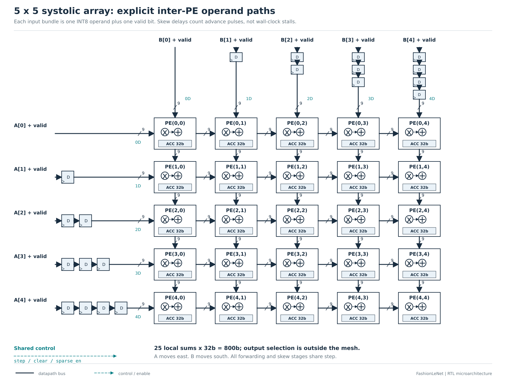
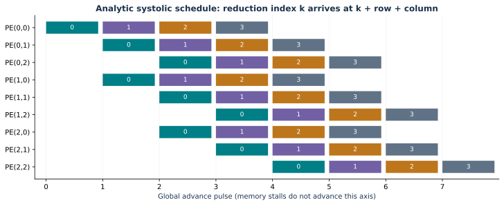
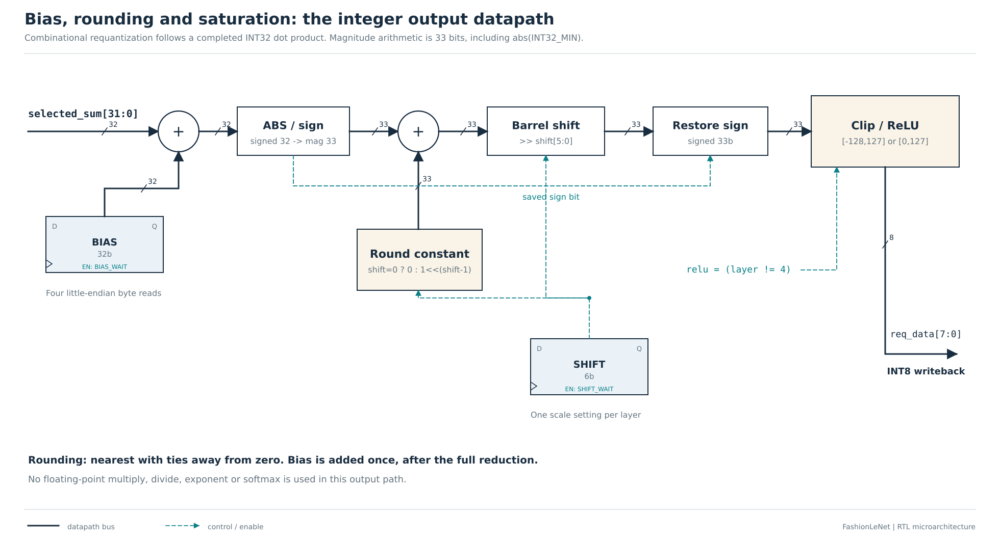
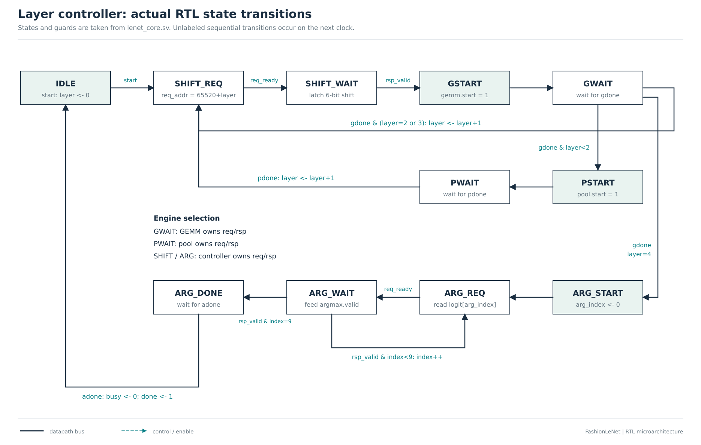

# Architecture, ownership, and scheduling


`fpga_top` is a portable synchronous accelerator core. A host loads bytes while
`host_ready=1`, pulses `start`, then waits for `done` and reads `prediction` and
counters. `sparse_en` and `cache_en` are latched when a start is accepted. Start
pulses and host writes during `busy` are ignored. Reset is synchronous, active high.
Memories are not cleared by reset; the host must initialize the parameter region
and each new input. The complete exported fixture initializes all 81,920 bytes.

## Convolution as a tiled matrix product

For each valid convolution, define `M=Hout*Wout`, `N=Cout`, and
`K=Cin*kernel*kernel`. A logical activation matrix has shape MxK, a weight matrix
has shape KxN, and the output is MxN. The activation matrix is **never materialized**.
For output spatial coordinate `m` and reduction coordinate `k`:

```text
output_y = m // Wout; output_x = m % Wout
input_channel = k // (kernel * kernel)
kernel_y = (k // kernel) % kernel; kernel_x = k % kernel
A_address = input_base + input_channel*Hin*Win
            + (output_y+kernel_y)*Win + output_x+kernel_x
B_address = weight_base + output_channel*K + k
```

Tensor storage is contiguous CHW. Weights are OIHW for convolution and OI for
dense layers. A dense layer is the same engine with Hin=Win=kernel=1 and M=1.

One tile owns up to ROWS output spatial positions and COLS output channels. The
scheduler gathers a boundary vector from the shared byte port, injects it once,
and freezes the network while gathering the next vector. This intentionally
simple front end prioritizes a transparent memory contract over peak throughput.

## Systolic timing and stalls





Activations move east and weights move south. West row `r` is skewed by `r`
**advance pulses**; north column `c` is skewed by `c` pulses. Reduction token k
meets at PE(r,c) at pulse `k+r+c`. A tile uses `K+ROWS+COLS-2` advance pulses,
including drain pulses. Tail rows/columns inject invalid tokens. Both inputs must
be valid to count as a candidate MAC. Every PE and skew register shares the same
advance enable; a memory stall cannot change pairing or ownership.

The accumulator is cleared at tile start and remains local for all K terms.
Output order is tile -> spatial row -> output channel, with addresses translating
back to CHW. Partial sums never travel through the cache. Bias addition and INT8
requantization happen once after the complete dot product. The same ownership
rule applies to rectangular arrays and incomplete edge tiles.

## Sparse PE behavior


`attempted = step & a_valid & b_valid`. In dense mode every candidate executes.
In sparse mode a candidate executes only if both operands are nonzero. Unused
multiplier operands are isolated to zero and the accumulator is held. A and B
still propagate with their valid bits; their logical coordinates are unchanged.
The design does not need a nonzero-index codec because it does not compact the
operand stream. Executed MACs are a functional counter, not a switching-energy
meter. Synthesis may transform the isolation logic; evaluate power with activity.

## Full inference controller

The controller reads one shift per weighted layer, launches the GEMM engine,
waits for all outputs to commit, then launches pooling where required. Conv1,
Conv2, and Conv3 write bank B; the first two pools write bank A. FC1 reads B and
writes A. FC2 reads A and writes ten signed logits to B. Argmax visits classes in
increasing order; ties preserve the first index. No exponential or softmax is
needed to choose the largest logit.

Counters reset at a new inference. `cycles` covers accepted start through the
completion protocol and excludes host loading. `mac_attempted` is the full
logical dot-product count; `mac_executed` reflects the selected gating mode.
Cache counters count read lookups; writes are excluded from hit/miss totals.
The one-byte shared memory path and runtime address division/modulo limit area
and speed. Banked/vector operand supply and counter-based address generation are
the next implementation improvements; no performance benefit from those future
changes is included in the measured results.

## Output and control schematics




