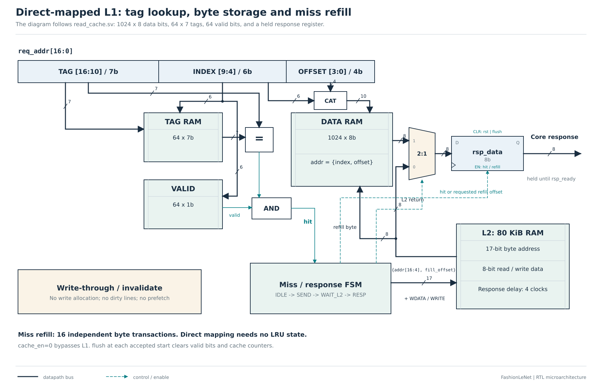

# Memory map and ready/valid protocol

| Byte address | Length | Meaning |
|---|---:|---|
| 0 .. W-1 | W | All layer weights, Conv1 -> Conv2 -> Conv3 -> FC1 -> FC2 |
| W .. W+4B-1 | 4B | All signed INT32 biases in the same layer order, little endian |
| W+4B .. 65519 | remainder | Unused, initialized to zero |
| 65520 .. 65524 | 5 | Unsigned right shifts for the five weighted layers |
| 65525 .. 65535 | 11 | Reserved, zero |
| 65536 .. 73727 | 8192 | Activation bank A, including a fresh input at each inference |
| 73728 .. 81919 | 8192 | Activation bank B |

For the 32-input model, W=61,470 and B=236. Biases end at address 62,413;
parameter payload including shifts is 62,419 bytes. For the 28-input model,
W=44,190 and the bias count is still 236: payload 45,139 bytes. An exporter rejects
models whose weights/biases overlap the shift region. Widths/input size in the
synthesized core must match the exported model configuration.

## Activation lifetimes

| Operation | Input bank | Output bank | Baseline 32-output shape (CHW) |
|---|---|---|---|
| Conv1 + ReLU | A | B | 6x28x28 |
| Pool1 | B | A | 6x14x14 |
| Conv2 + ReLU | A | B | 16x10x10 |
| Pool2 | B | A | 16x5x5 |
| Conv3 + ReLU | A | B | 120x1x1 |
| FC1 + ReLU | B | A | 84 |
| FC2 | A | B | 10 |
| Argmax | B | scalar output | class 0..9 |

The input is overwritten by Pool1. To run another image, reload its bytes into
bank A while idle; reloading weights is unnecessary unless the model changes.
Reset clears control state and valid bits, not SRAM contents. Host and internal
memory writers have mutually exclusive ownership through `busy/host_ready`.

## Cache policy

Address fields are tag `[16:10]`, index `[9:4]`, offset `[3:0]`. The 1 KiB L1 has
64 lines of 16 bytes, with seven tag bits and one valid bit per line: 512 extra
metadata bits. A read hit produces a response on the next clock. On a miss, the
controller fetches all sixteen bytes from L2, then responds. There is no burst
port: each byte is an independent four-cycle backing transaction. This cost is
included in RTL results and the timing model.

Writes pass through to L2 and invalidate the indexed L1 line, even when its tag
belongs to another address. This conservative rule is correct and simplifies
coherence. There is no dirty state, writeback, write allocation, prefetch, LRU, or
external DRAM. Both weights and activations can be cached; conflict effects are
visible in the results. New inference starts flush all L1 valid bits/counters.

## Handshakes and latency accounting

A request is accepted only on a rising edge with `req_valid && req_ready`.
Request address/data/write flag remain stable until that edge. The response
asserts `rsp_valid`; its data is held until `rsp_ready`. One transaction is in
flight at a time. A write also receives a completion response. L2 asserts its
response exactly LATENCY clocks after accepting a request. Ready/valid staging
adds other clocks to the engine-visible cost:

| Access | Engine clocks per transaction, with immediate response acceptance |
|---|---:|
| L1 read hit | 2 |
| L1 read miss, 16-byte fill | 2 + 16*(LATENCY+2) |
| L1 bypass read | LATENCY+4 |
| Write-through write | LATENCY+4 |

These costs include scheduler request/wait transitions. They are not physical
SRAM access times. The complete timing model also includes tile clear/feed/drain,
masked lane slots, pooling, shifts, layer launches and argmax completion.
