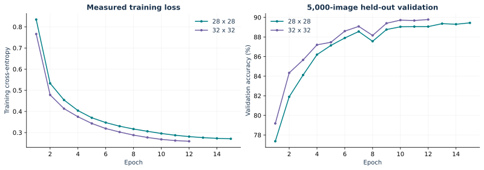
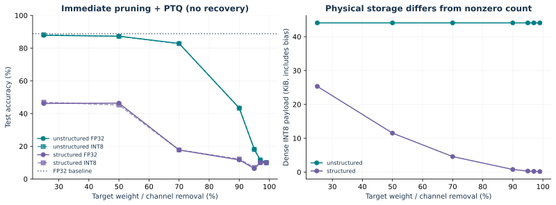
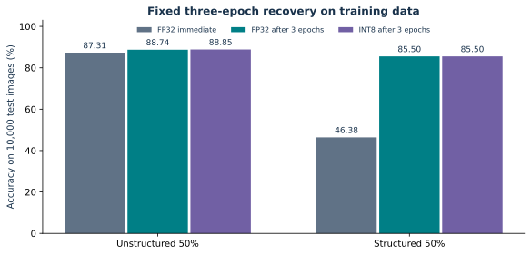
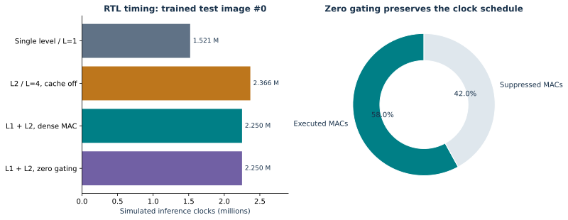

# Measured project results

Generated from the stored JSON/CSV logs. Test accuracy uses all 10,000 official test images; RTL evidence covers the listed complete-image regressions.

## Baselines and quantization

| Input | FP32 test | INT8 test | Test images |
|---|---|---|---|
| 28 x 28 | 88.84% | 88.79% | 10000 |
| 32 x 32 | 89.30% | 89.03% | 10000 |

Both models use training/validation split selection; calibration uses 500 images from the official training split. The 32-input model was trained for 12 epochs and the 28-input model for 15. The best validation checkpoint is evaluated, not a test-selected checkpoint.

## Full pruning sweep, native 28-input network

| Method | Target removal | Actual widths | Parameters | Nonzero weights | FP32 test | INT8 test | INT8 bytes |
|---|---|---|---|---|---|---|---|
| baseline | 0% | [6, 16, 120, 84] | 44426 | 44190 | 88.84% | 88.79% | 45139 |
| unstructured | 25% | [6, 16, 120, 84] | 44426 | 33143 | 87.84% | 88.25% | 45139 |
| unstructured | 50% | [6, 16, 120, 84] | 44426 | 22095 | 87.31% | 87.21% | 45139 |
| unstructured | 70% | [6, 16, 120, 84] | 44426 | 13258 | 82.85% | 82.79% | 45139 |
| unstructured | 90% | [6, 16, 120, 84] | 44426 | 4419 | 43.41% | 43.32% | 45139 |
| unstructured | 95% | [6, 16, 120, 84] | 44426 | 2210 | 18.24% | 18.01% | 45139 |
| unstructured | 97% | [6, 16, 120, 84] | 44426 | 1326 | 11.53% | 11.66% | 45139 |
| unstructured | 99% | [6, 16, 120, 84] | 44426 | 442 | 9.98% | 10.00% | 45139 |
| structured | 25% | [5, 12, 90, 63] | 25385 | 25205 | 46.19% | 46.95% | 25930 |
| structured | 50% | [3, 8, 60, 42] | 11418 | 11295 | 46.38% | 45.26% | 11792 |
| structured | 70% | [2, 5, 36, 26] | 4455 | 4376 | 17.75% | 17.77% | 4697 |
| structured | 90% | [1, 2, 12, 9] | 691 | 657 | 11.69% | 12.20% | 798 |
| structured | 95% | [1, 1, 6, 5] | 249 | 226 | 6.39% | 7.08% | 323 |
| structured | 97% | [1, 1, 4, 3] | 175 | 156 | 10.00% | 10.00% | 237 |
| structured | 99% | [1, 1, 2, 1] | 109 | 94 | 10.00% | 10.00% | 159 |

Target fraction is weight removal for unstructured pruning and hidden width removal for structural pruning. Kept widths use ceil, with at least one unit and all ten output classes. Dependency removal can reduce total parameters by a different percentage. Unstructured dense storage does not shrink. INT8 bytes include INT32 biases and five shifts.

## Recovery after 50% pruning

| Method | Epochs | Immediate FP32 | Recovered FP32 | Recovered INT8 | INT8 bytes |
|---|---|---|---|---|---|
| baseline | 0 | 88.84% | 88.84% | 88.79% | 45139 |
| unstructured | 3 | 87.31% | 88.74% | 88.85% | 45139 |
| structured | 3 | 46.38% | 85.50% | 85.50% | 11792 |

Recovery uses a fixed three-epoch Adam run at 1e-4 on the 55,000-image training partition. Unstructured masks are enforced after every optimizer step. PTQ follows recovery; PTQ itself does not retrain.

## RTL and memory experiments

| Bundle | Sparse | Cache | L2 clocks | RTL clocks | Executed MACs | Candidate MACs | Class |
|---|---|---|---|---|---|---|---|
| trained32_image1 | 1 | 1 | 4 | 2249791 | 302578 | 416520 | 2 |
| trained32_image2 | 1 | 1 | 4 | 2249791 | 240250 | 416520 | 1 |
| trained32_image8 | 1 | 1 | 4 | 2249791 | 205831 | 416520 | 5 |
| trained28 | 1 | 1 | 4 | 2901741 | 166921 | 281640 | 9 |
| trained32 | 0 | 0 | 1 | 1520524 | 416520 | 416520 | 9 |
| trained32 | 0 | 1 | 4 | 2249791 | 416520 | 416520 | 9 |
| trained32 | 1 | 0 | 4 | 2366413 | 241553 | 416520 | 9 |
| trained32 | 1 | 1 | 4 | 2249791 | 241553 | 416520 | 9 |
| pruned28 | 1 | 1 | 4 | 2901741 | 115342 | 281640 | 9 |
| structured28 | 1 | 1 | 4 | 460561 | 53034 | 92220 | 9 |

All 10 listed cases pass every INT32 writeback and every INT8 stage comparison. All 11 module benches pass. The independent transaction model matches clocks, candidate/executed MACs, hits, misses and bypasses for every listed case.

The primary 32-input cached pair uses identical 2,249,791-clock schedules with and without zero gating. Sparse execution removes 174,967 MACs (42.01%) for test image #0. With the same four-clock L2, caching reduces 2,366,413 to 2,249,791 clocks (4.93%). The one-level, one-clock backing baseline takes 1,520,524 clocks; it is a faster memory assumption, so it is not the matched denominator for cache benefit.

The native 28-input default layout has worse cache conflicts despite fewer MACs. The 50% structured 28-input model has 92,220 candidate MACs and a 460,561-clock inference for image #0, while its full-dataset INT8 accuracy is 85.50%. Gating alone does not reduce memory requests or clocks. These results expose the front end and mapping tradeoffs rather than claiming uniform acceleration.

## CPU, synthesis and power

The local batch-one FP32 CPU run has median **0.192781 ms**, p05 0.185708 ms, p95 0.291278 ms, one thread, 30 warm-up calls and 200 timed calls. It is not a Colab measurement. The notebook provides the same experiment for Colab.

At a hypothetical achieved 100 MHz, the cached 32-input design would take 22.49791 ms. This byte-serial educational design is slower than the local CPU. This number is a clock conversion, not measured FPGA latency. Host model/image transfer is excluded.

Yosys proc/opt/memory collection and structural checking pass for the complete top and the array. Generic optimized IR contains 1,341 cells for the complete top and 573 for the array; 25 of the array cells are multiply operators. These are not LUT, FF, DSP or BRAM primitive counts. Runtime div/mod address generation and the byte port are visible implementation bottlenecks.

Vivado synthesis/place/route, achieved setup/hold timing, mapped resources, activity-annotated power and on-board execution are **not run**. Their result fields are null in `results/fpga_status.json`. The FPGA scripts, analysis method, workload fixtures and source references are provided so these measurements can be completed without substituting invented values.

## Evidence and limitations

The source PDF's ambiguities are resolved in [REQUIREMENTS.md](REQUIREMENTS.md). The arithmetic, memory policy and verification coverage are specified separately. Source data, scripts, logs, checkpoints and editable figures are included. The instructor's report template was not attached; the report content below must be transferred into that required template for formal submission.
